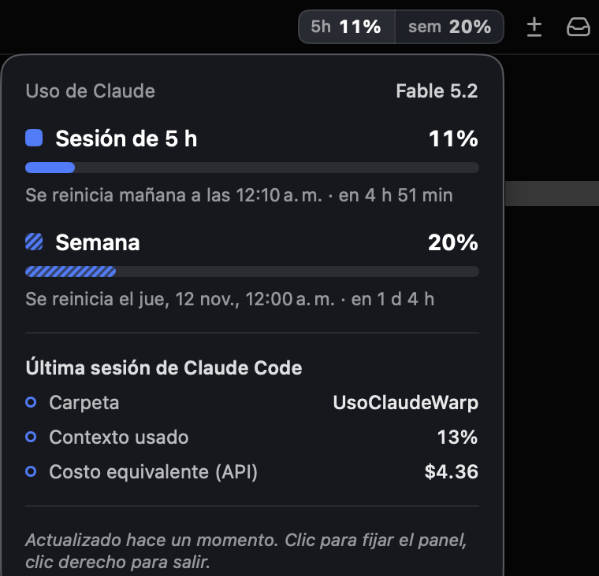

# WarpConsumo

Un botón en la barra superior de [Warp](https://www.warp.dev) que muestra cuánto llevas usado de tu plan de Claude: la ventana de 5 horas y la semana. Al pasar el mouse despliega un panel con el detalle y la hora en que se reinicia cada límite.



Warp no permite agregar botones propios, así que esto es una app nativa pequeña de macOS que flota sobre la barra de Warp y sigue su ventana. Solo aparece cuando Warp está al frente.

## Requisitos

- macOS 13 o superior y Warp.
- [Claude Code](https://code.claude.com) con una suscripción de Claude (Pro, Max o Ultra). Con una API key no hay límites de plan que mostrar.
- Herramientas de línea de comandos de Xcode: `xcode-select --install`
- `jq`: `brew install jq`

## Instalar

```bash
git clone https://github.com/Perezhppr/WarpConsumo.git
cd WarpConsumo
./instalar.sh
```

El instalador hace cuatro cosas:

1. Compila la app y la copia a `~/Applications/UsoClaudeWarp.app`.
2. Copia `statusline.sh` a `~/.claude/uso-claude/`.
3. Registra ese script como status line de Claude Code en `~/.claude/settings.json`. Si ya tienes otro status line no lo toca y te avisa (ver abajo).
4. Deja la app arrancando sola al iniciar sesión, con un LaunchAgent.

Después envía cualquier mensaje en Claude Code: los números aparecen con la primera respuesta.

## Cómo se usa

- **Pasar el mouse** sobre el botón abre el panel.
- **Clic** fija el panel abierto; otro clic lo suelta.
- **Clic derecho** › «Salir de Uso Claude» cierra la app.

Los porcentajes cambian de color al acercarse al límite: ámbar desde 70 % y rojo desde 90 %.

## De dónde salen los datos

Claude Code le pasa a su status line un JSON con el estado de la sesión, que incluye `rate_limits.five_hour` y `rate_limits.seven_day`. `statusline.sh` guarda esos valores en `~/.claude/uso-claude/estado.json` y la app lee ese archivo cada 2 segundos.

El bloque que el instalador agrega a `~/.claude/settings.json` es este, por si prefieres ponerlo a mano:

```json
"statusLine": { "type": "command", "command": "~/.claude/uso-claude/statusline.sh" }
```

No se usa el token de tu cuenta, no se llama a ninguna API y nada sale de tu Mac.

Por eso mismo, los números se actualizan cuando Claude Code responde algo. Lo que uses en claude.ai o en la app de escritorio aparece con la siguiente respuesta de Claude Code.

Con varias sesiones de Claude Code abiertas, cada una trae el uso tal como estaba en su última respuesta. El script se queda con el dato más reciente y descarta los de sesiones inactivas, así el botón y la línea de estado de todas las sesiones muestran el mismo número. El bloque «Última sesión de Claude Code» del panel sí cambia: muestra la sesión que se redibujó de último, normalmente la pestaña en la que estás.

El «Costo equivalente (API)» es el estimado que calcula Claude Code a precio de lista. No es un cobro de tu suscripción.

## Si ya tienes un status line

El instalador no lo reemplaza. Para alimentar el botón, pasa el mismo JSON a este script desde el tuyo, descartando lo que imprime:

```bash
input=$(cat)
printf '%s' "$input" | ~/.claude/uso-claude/statusline.sh > /dev/null
# ...el resto de tu status line usa "$input"
```

## Ajustar la posición

El botón se coloca respecto a la esquina superior derecha de la ventana de Warp. Si queda encima de algo o Warp cambia su barra:

```bash
defaults write pe.hugorocha.usoclaudewarp derecha -float 96   # distancia al borde derecho
defaults write pe.hugorocha.usoclaudewarp arriba -float 7     # distancia al borde superior
```

Cierra la app y vuelve a abrirla para que tome los valores.

## Desinstalar

```bash
./instalar.sh --quitar
rm -rf ~/Applications/UsoClaudeWarp.app ~/.claude/uso-claude
```

Y quita el bloque `statusLine` de `~/.claude/settings.json` si lo agregó el instalador.

## Limitaciones

- Solo macOS.
- Probado con Warp 0.2026.10.21. La posición por defecto está calculada para esa barra.
- Mientras mueves o cambias de tamaño la ventana de Warp, el botón se esconde y reaparece al soltarla.
- La app no está firmada con una cuenta de desarrollador: se compila en tu Mac desde el código.

## Desarrollo

Todo el código de la app está en `app/main.swift`. `./construir.sh --abrir` compila y abre la app desde `build/` sin instalar nada.

## Licencia

MIT. Ver [LICENSE](LICENSE).
